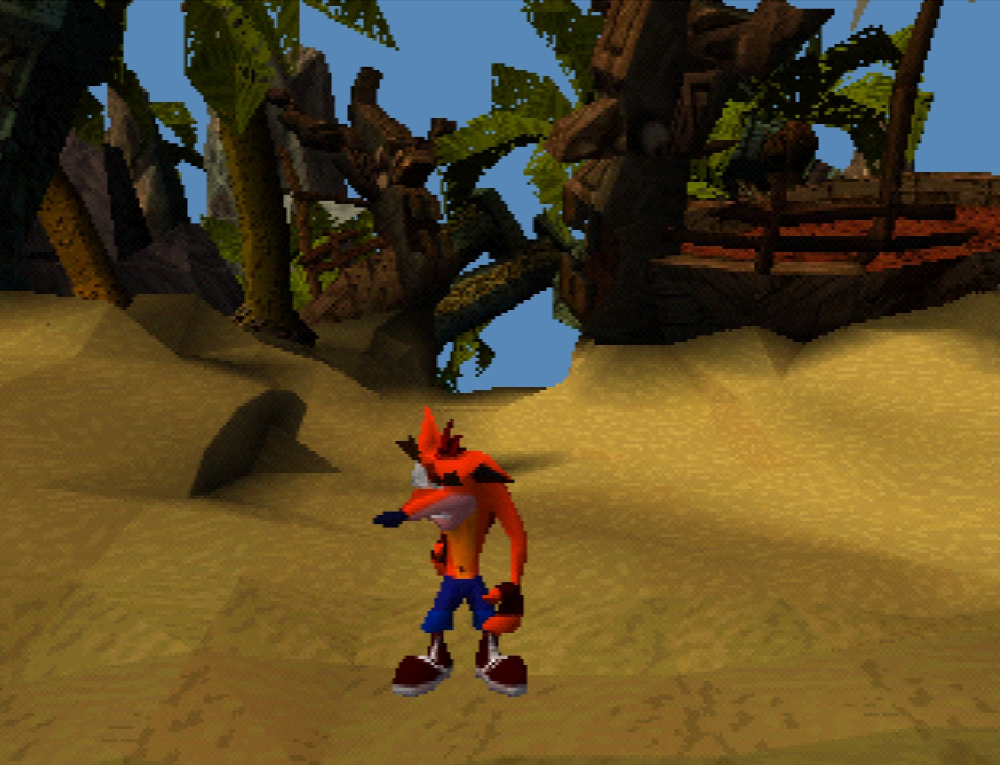

# crash64

This is an N64 port of Crash Bandicoot!

## Current progress

(Applies to same commit of this README.)

Crash can walk, jump, and spin in the first level chunk of N. Sanity Beach. Camera follows him.

- Control Stick: movement
- A: jump
- B: spin
- C-Up: manually trigger the Wumpa idle animation

## Notice

This project is Source-Available, not Open-Source. The repository contains only source code for this port and built ROM. External dependencies and assets are not included.

The files here are for educational and viewing purposes only, not for reproducible builds, because I cannot provide copyrighted assets.

Please enjoy!

## Tools used
- ares (N64 Emulator)
- Blender
- c1 decompilation project
- CrashEdit
- Libdragon
- Tiny3D
